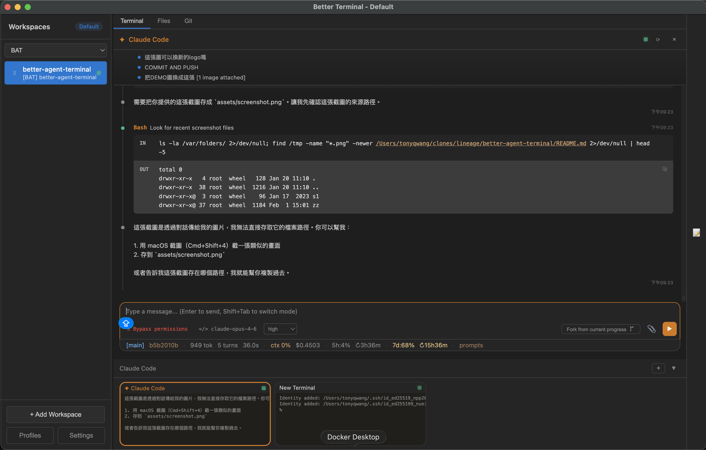
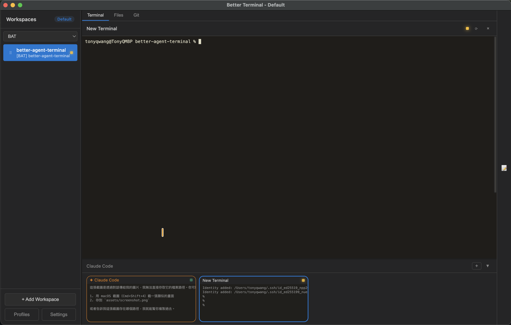

# Better Agent Terminal

<div align="center">


[](https://github.com/gowerlin/better-agent-terminal/releases)


**跨平台終端機聚合器，支援多工作區管理與內建 AI Agent 整合**

在同一個視窗中管理多個專案終端機，內建支援 **Claude Code、Gemini CLI、GitHub Copilot CLI、Codex CLI** 及任意自訂 CLI 代理。附帶檔案瀏覽器、Git 檢視器、Snippet 管理器、遠端存取，以及可協調多個 AI Agent 的 **Supervisor 模式**。

[下載最新版本](https://github.com/gowerlin/better-agent-terminal/releases/latest)

</div>

---

## 擷圖

<div align="center">

**Claude Code Agent 面板** — 內建 AI Agent，支援權限控制、狀態列與串流輸出


**終端機** — 在 Agent 旁執行持久終端機，方便運行長時間指令與監控


</div>

---

## 功能特色

### 🖥️ 工作區管理
- 多工作區標籤頁，支援拖放排序與分組
- 每個工作區獨立的終端機實例、Agent 對話與環境變數
- 工作區封存與排序管理
- 跨重啟保存工作區狀態
- 可分離式視窗 — 將工作區拉出為獨立視窗

### 🤖 AI Agent 整合
- **Claude Code (SDK)** — 結構化事件、權限控制、對話續接
- **Claude Code (CLI)** — 完整 CLI 體驗
- **Gemini CLI** — Google AI 助手，支援沙箱模式
- **GitHub Copilot CLI** — GitHub AI 程式助手
- **Codex CLI** — OpenAI 程式代理，支援沙箱/YOLO 模式
- **自訂 CLI** — 從設定中新增任意 CLI 工具作為 Agent
- **用量限制自動繼續**（設定 > 進階，預設關閉）— yolo 分頁撞到 5 小時用量限制時，Codex 於解鎖後自動輸入續行文字；Claude CLI 自行續行，BAT 只標示

### ⭐ 指令自動完成
- `*` 前綴觸發星號指令（掃描 `ct-*`、`gsd-*` 等 Skill）
- AI 內建指令前綴依 runtime 決定，Claude Code 用 `/`，Codex 用 `$`
- Agent 面板與 PromptBox 均支援
- 鍵盤導航選取

### 🏗️ Control Tower 整合
- **看板檢視** — 視覺化管理工單狀態（待辦 / 進行中 / 已完成）
- **Sprint 進度** — 即時追蹤 Sprint 完成百分比
- **工單操作** — 一鍵執行 `ct-exec`、`ct-done`、`ct-sync`，並依 default agent 自動選擇 Claude `/` 或 Codex `$` 前綴
- **CtToast 通知** — 工單狀態變更即時通知
- **塔台 / Worker 分頁** — 派工分頁標題顯示 `Agent · Worker · T####`、回報後標示 ✓；塔台分頁標題 `Agent · Tower`；塔台可回收自己派出的 Worker 分頁（`bat-terminal.mjs --close-worker`），或右鍵批次關閉已回報的 Worker

### 👁 Supervisor 模式
- 指定一個終端機為 Supervisor，監控其他 Worker 終端機
- Worker 面板顯示各 Worker 的代理類型、狀態與最近輸出
- 快速發送指令給任意 Worker
- 適用場景：TDD 工作流、Code Review 管線、平行任務分派

### 📡 遠端存取
- 內建 WebSocket 伺服器，供其他 BAT 實例或行動裝置連線
- Remote Profile 連線（BAT 對 BAT）
- QR Code 掃描連線（行動裝置）
- 自動偵測 Tailscale IP，建議用於跨網路連線

### 🌐 Remote dev support
- 在同一個 BAT 視窗中跨 **WSL / Docker / SSH (Linux/macOS)** 環境驅動 AI Agent
- 統一 setup wizard：安裝 server bundle → 啟動服務 → TLS fingerprint pinning → 連線驗證
- 跨環境 path translator 自動轉換 chat context 附件路徑（Windows ↔ Linux ↔ macOS）
- 可同時開啟多個遠端 profile 的視窗（最多 8 個連線）
- 遠端 AI 工具面板：偵測並一鍵安裝遠端的 claude / codex / Node.js（nvm）等工具
- 詳見 [Remote Dev Overview](docs/remote-dev-overview.md)
- Server bundle 分發機制（安裝檔不內建；第一次設定時從 GitHub Release 下載並快取，離線時可匯入本機 tarball）詳見 [Server Bundle Distribution](docs/server-bundle-distribution.md)

### 📊 狀態列
- 13 項可配置狀態顯示（模型、成本、Token、快取等）
- 自訂顏色、區域對齊與範本設定
- API 用量輪詢：Chrome Session Key（主要）→ OAuth（備用）

### 🔧 其他功能
- 終端機縮圖列 — 快速切換多終端機
- 內建檔案瀏覽器與 Git 檢視器
- Snippet 管理器 — 儲存與快速插入常用指令
- 可點擊的檔案路徑與 URL 連結
- 終端貼上依剪貼簿內容處理：檔案 → 加引號的路徑、圖片 → 送給 claude CLI 貼圖、文字 → 一般貼上
- 工作區設定（每工作區獨立）：環境變數、預設 Agent、各 Agent 的啟動參數
- Git Worktree 隔離 — 在獨立 worktree 中運行 Agent
- 自動更新檢查
- 多語系支援（繁體中文 / 英文 / 簡體中文）
- 深色主題 UI

---

## 快速開始

### 方式一：直接下載

從 [Releases](https://github.com/gowerlin/better-agent-terminal/releases/latest) 下載對應平台安裝包：

| 平台 | 檔案格式 |
|------|---------|
| Windows | `.exe` 安裝檔 或 `.zip` 免安裝版 |
| macOS | `.dmg`（Apple Silicon / arm64；自 v0.6.0-pre.3 起不支援 Intel Mac，D136） |
| Linux | `.AppImage` |

> macOS 首次執行可能會被阻擋 — 前往 **系統設定 > 隱私與安全性**，下滑點選 **仍要打開**。

### 方式二：從原始碼建置

**前置需求：**
- [Node.js](https://nodejs.org/) 20.19+（Vite 7 的最低需求；CI 使用 Node 24）
- [Claude Code CLI](https://docs.anthropic.com/en/docs/claude-code) 或 [Codex CLI](https://developers.openai.com/codex/) 至少其一已安裝並驗證

```bash
git clone https://github.com/gowerlin/better-agent-terminal.git
cd better-agent-terminal
npm install
```

**開發模式：**
```bash
npm run dev
```

**建置正式版：**
```bash
npm run build
```

### 方式三：快速安裝腳本

```bash
curl -fsSL https://raw.githubusercontent.com/gowerlin/better-agent-terminal/main/install.sh | bash
```

---

## 鍵盤快速鍵

| 快速鍵 | 功能 |
|--------|------|
| `Ctrl+T` | 新增終端機 |
| `Ctrl+W` | 關閉目前終端機 |
| `Ctrl+Tab` | 切換下一個終端機 |
| `Ctrl+Shift+Tab` | 切換上一個終端機 |
| `Ctrl+1~9` | 切換至指定終端機 |
| `Ctrl+K` | 清除終端機 |
| `Ctrl+Shift+V` | 貼上到終端機 |
| `Ctrl+N` | 新增工作區 |
| `Ctrl+Shift+N` | 開啟新視窗 |

---

## 架構

```
better-agent-terminal/
├── electron/                          # 主程序 (Node.js)
│   ├── main.ts                        # 應用程式入口、IPC 處理、視窗管理
│   ├── preload.ts                     # Context Bridge (window.electronAPI)
│   ├── pty-manager.ts                 # PTY 程序生命週期、輸出批次、環形緩衝
│   ├── claude-agent-manager.ts        # Claude SDK 工作階段管理
│   ├── worktree-manager.ts            # Git worktree 生命週期
│   ├── agent-runtime/                 # 通用 Agent 運行層
│   ├── logger.ts                      # 磁碟日誌（預設開啟，Settings 可關）
│   ├── snippet-db.ts                  # Snippet 儲存（snippets.json）
│   ├── profile-manager.ts             # 設定檔 CRUD
│   ├── update-checker.ts              # GitHub Release 更新檢查
│   └── remote/                        # 遠端存取模組
├── src/                               # 渲染程序 (React)
│   ├── App.tsx                        # 根元件、佈局
│   ├── components/                    # UI 元件
│   ├── stores/                        # 狀態管理
│   ├── types/                         # 型別定義
│   └── styles/                        # 樣式表
└── package.json
```

### 技術堆疊

| 類別 | 技術 |
|------|------|
| 前端 | React 18 + TypeScript 5 |
| 終端機 | xterm.js 5（`@xterm/xterm`）+ node-pty（`@lydell/node-pty`） |
| 框架 | Electron 41 |
| AI | `@anthropic-ai/claude-agent-sdk`（內嵌 `@anthropic-ai/claude-code` CLI）+ `@openai/codex-sdk` |
| 建置 | Vite 7 + electron-builder 26 |
| 儲存 | JSON 檔（`settings.json`、`windows.json`、`profiles/`、`snippets.json` 等，位置見「設定」） |
| 遠端 | ws（WebSocket，`wss://` + `selfsigned` 自簽憑證）+ qrcode |
| Git | simple-git |
| Markdown 預覽 | marked + mermaid |
| 語法標示 | highlight.js |
| 語音輸入 | `@kutalia/whisper-node-addon`（whisper.cpp） |
| 多語系 | i18next + react-i18next |
| 測試 | Vitest + Playwright |

---

## 發行

### 版本格式

遵循語意化版號：`vMAJOR.MINOR.PATCH`（例如 `v0.6.1`）

預覽版使用 `-pre.N` 後綴（例如 `v0.6.1-pre.8`），GitHub Release 標記為 Pre-release。各版更版重點見 [release-note.md](release-note.md)，完整變更見 [CHANGELOG.md](CHANGELOG.md)。

### 預覽版（`pre-release.yml`）

只能以 `workflow_dispatch` 手動觸發（push tag 不會觸發）。版號必須顯式指定、不帶 `v`：

```bash
gh workflow run pre-release.yml -R gowerlin/better-agent-terminal -f version=X.Y.Z-pre.N
```

> 版號留空會走自動遞增，而 repo 內混有上游的 `v2.x` / `v4.x` tag，會遞增出與本 fork 主線（`v0.x`）脫節的版號。請以 `v0.x` 主線最新 tag 判定下一版。`gh` 請一律帶 `-R gowerlin/better-agent-terminal`。

### 正式版（`release.yml`）

推送 `vX.Y.Z` tag 觸發三平台建置與發行：

```bash
git tag v0.6.1
git push origin v0.6.1
```

兩條線都會同時發佈對應的 `server-bundle-v<版號>` release。

---

## 設定

BAT 的所有資料都在同一個目錄（打包版與 `npm run dev` 相同）：

| 平台 | 資料目錄 |
|------|------|
| Windows | `%APPDATA%\BetterAgentTerminal\` |
| macOS | `~/Library/Application Support/BetterAgentTerminal/` |
| Linux | `~/.config/BetterAgentTerminal/` |

其中包含 `settings.json`、`windows.json`（視窗與工作區）、`profiles/`、`server-cert.json` / `server-token.json`（遠端存取）、`whisper-models/`、`snippets.json`，以及 `Logs/`（除錯日誌）、`Crashes/`（crash dump）。

**多實例**：以 `--runtime=<N>` 或環境變數 `BAT_RUNTIME=<N>` 啟動，可另開一個資料獨立的實例（各自的單一實例鎖），所有資料（含 `snippets.json`、`Logs/`、`Crashes/`）都在 `BetterAgentTerminal-runtime-<N>/`（與上表同一個上層目錄，例如 Windows 的 `%APPDATA%\BetterAgentTerminal-runtime-<N>\`）。

#### 從舊版升級（v0.6.0-pre.3 以前）

舊版把一部分資料放在小寫的 `better-agent-terminal/`（與上表同一個上層目錄）：`Logs/`、`Crashes/`、`snippets.json`、`message-archives/` 與 `Local State`（Chromium 狀態檔；Windows 上用來解開遠端存取權杖的加密金鑰存在這裡）；`--runtime=<N>` 實例則整個在 `better-agent-terminal-runtime-<N>/`。新版第一次啟動時會自動整理，只執行一次（完成後在資料目錄寫入 `.userdata-migration.json`）：

| 項目 | 處理方式 |
|------|------|
| `Local State` | 資料目錄還沒有時才**複製**過來，遠端存取權杖不變、遠端 client 不需重新配對（macOS / Linux 的加密金鑰在系統 Keychain / libsecret，升級後權杖不變尚待實機確認）。若複製失敗，權杖會重新產生，遠端 client 需要重新配對（日誌中有 `[userdata-migration]` 紀錄） |
| `snippets.json` | 資料目錄沒有時**複製**；兩邊都有時合併（以資料目錄為主，舊檔中不重複的項目附加在後，合併前先備份成 `snippets.json.pre-merge-<時間>.bak`） |
| `message-archives/*.jsonl` | 資料目錄沒有同名檔時**移動**過來（這是對話訊息的快取） |
| `Logs/`、`Crashes/` | **不搬**。新日誌寫到資料目錄的 `Logs/`；舊日誌留在 `better-agent-terminal/Logs/` |
| `better-agent-terminal-runtime-<N>/` | 整個目錄**改名**為 `BetterAgentTerminal-runtime-<N>/`。若該實例的 terminal server 仍在執行或改名失敗，這次先沿用舊目錄，下次啟動再試。runtime 實例的 snippets 各自一份，不會從預設實例複製 |

舊的 `better-agent-terminal/` **保留不刪除、也不會自動清理**（舊日誌在那裡），確認不再需要降版後可自行刪除。

**降版回舊版**：

- 預設實例：舊版照舊讀寫 `better-agent-terminal/` 與 `BetterAgentTerminal/`，設定與遠端存取權杖都可沿用。但新版新增或修改的 snippets 舊版看不到；在舊版期間修改的 snippets，再次升級時**不會**重新搬移（只執行一次）
- runtime 實例：目錄已改名，舊版會建立一個全新的空目錄；資料仍在 `BetterAgentTerminal-runtime-<N>/`，可手動改名回 `better-agent-terminal-runtime-<N>/`

⚠️ **不要同時執行新舊兩個版本**：兩者的單一實例鎖在不同目錄、無法互斥，會同時寫入同一份 `settings.json`。

### 除錯日誌

除錯日誌**預設開啟**，不需要環境變數。日誌寫在資料目錄下的 `Logs/debug-<YYYYMMDD-HHMMSS>.log`，每次啟動一個檔案，保留最近 10 個。可在 BAT 的 **設定 > 進階 > 除錯日誌** 關閉、調整等級（預設 `debug`），或按「開啟日誌資料夾」直接開啟目錄；回報 bug 時請附上最新的日誌檔。

`BAT_DEBUG=1` 與磁碟日誌無關，它只開啟僅供除錯的 UI（debug 用 Agent preset、worktree 選項等）。

### 語音輸入 — 跨平台麥克風權限

#### macOS
- 首次使用語音輸入時會彈出系統權限對話框
- 拒絕後可至「系統設定 > 隱私與安全性 > 麥克風」重新授權
- 要求 macOS 12 (Monterey) 以上（Electron 41 的最低需求）與 Apple Silicon
- App 的 Info.plist 已包含 `NSMicrophoneUsageDescription`，打包後可正常觸發系統權限提示

#### Windows
- 首次使用時 Chromium 觸發權限對話框
- 若系統層全域麥克風存取關閉，請至「設定 > 隱私 > 麥克風」開啟
- Windows 10/11 原生支援

#### Linux
- 依 PulseAudio / PipeWire 設定
- 首次使用時通常無需額外操作
- 若無法存取，請確認 `pactl` / `pipewire` 服務運作正常

---

## 授權

MIT License — 詳見 [LICENSE](LICENSE)。

---

## 致謝

本專案 fork 自以下優秀的開源專案：

- **原始專案** — [tony1223/better-agent-terminal](https://github.com/tony1223/better-agent-terminal) by **TonyQ** ([@tony1223](https://github.com/tony1223))
- **中間 fork** — [scandnavik/better-agent-terminal](https://github.com/scandnavik/better-agent-terminal)

### 原始貢獻者

- **lmanchu** ([@lmanchu](https://github.com/lmanchu)) — macOS/Linux 支援、工作區角色
- **bluewings1211** ([@bluewings1211](https://github.com/bluewings1211)) — Shift+Enter 換行、保留工作區狀態、可調整面板
- **Henry Hu** ([@ninedter](https://github.com/ninedter)) — Key API 發現與架構回饋
- **craze429** ([@craze429](https://github.com/craze429)) — Windows/Linux 憑證讀取、權限修正、Git 解析修正
- **Owen** ([@Owen0857](https://github.com/Owen0857)) — Windows 殭屍程序修正、終端機重設大小黑屏修正
- **MikeThai** ([@mikethai](https://github.com/mikethai)) — macOS .dmg spawn ENOENT 修正
- **Luke Chang** ([@lukeme117](https://github.com/lukeme117)) — Snippet 側邊欄與 UI 改進

---

<div align="center">

Built with Claude Code

</div>
