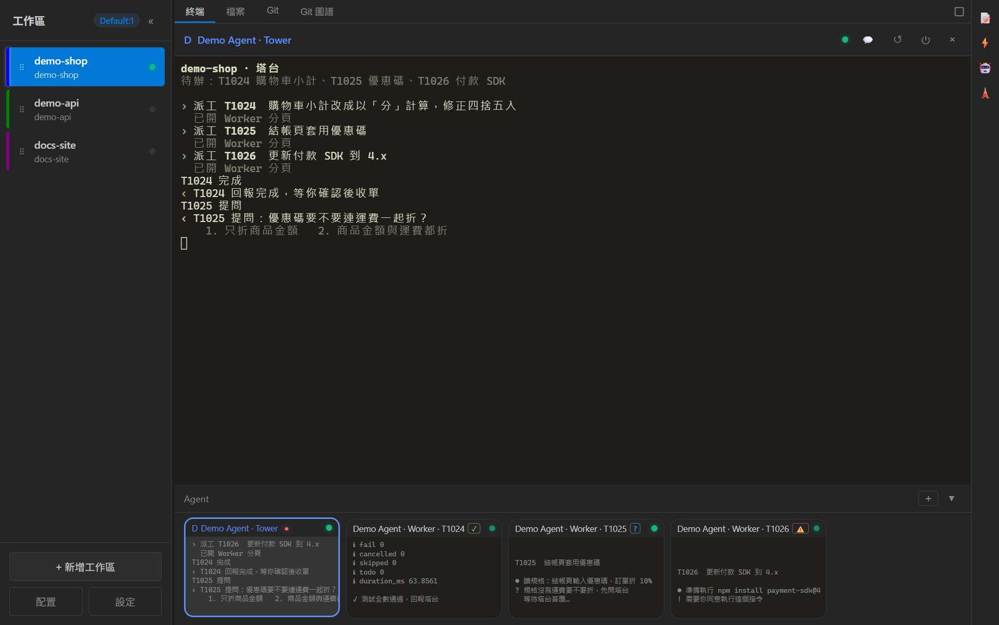
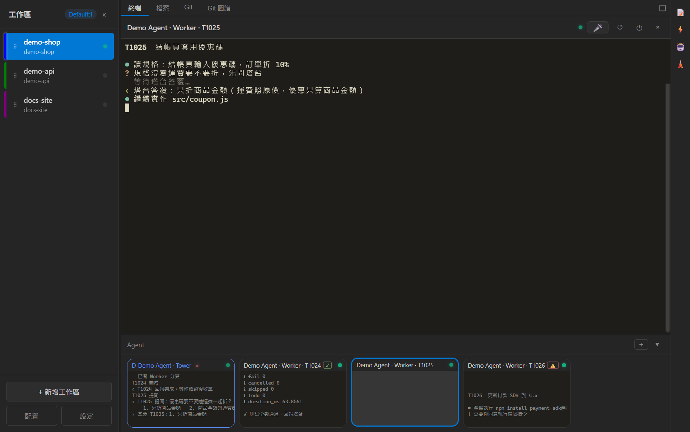
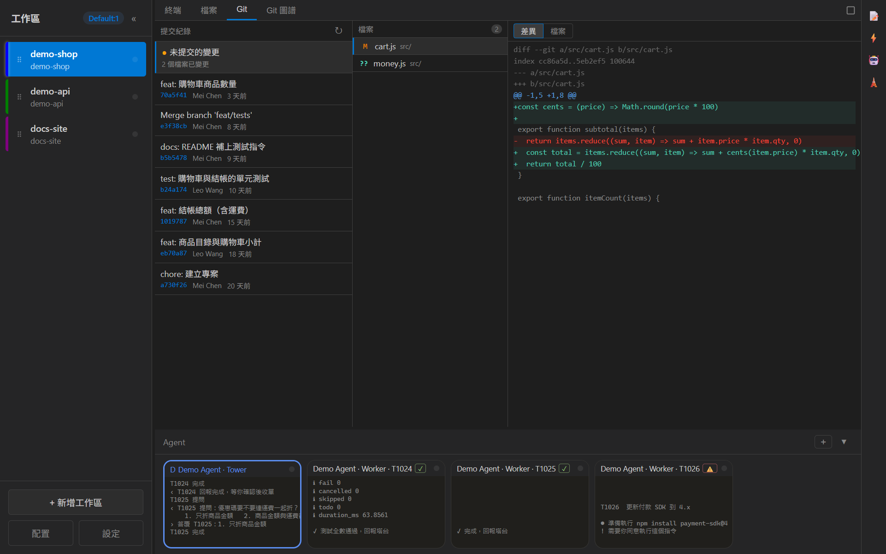

# Better Agent Terminal

<div align="center">


[](https://github.com/gowerlin/better-agent-terminal/releases)


[](https://gowerlin.github.io/better-agent-terminal/)

**跨平台終端機聚合器，支援多工作區管理與內建 AI Agent 整合**

在同一個視窗中管理多個專案終端機，內建支援 **Claude Code、Gemini CLI、GitHub Copilot CLI、Codex CLI** 及任意自訂 CLI 代理。附帶檔案瀏覽器、Git 檢視器、Snippet 管理器、遠端存取，以及可協調多個 AI Agent 的 **Supervisor 模式**。

[專案網站](https://gowerlin.github.io/better-agent-terminal/) · [下載最新版本](https://gowerlin.github.io/better-agent-terminal/#download)

</div>

---

## 擷圖

<div align="center">

**工作區與分頁** — 每個專案一個工作區；塔台分頁派出的 Worker，縮圖會標出 ✓ 已回報、? 在等塔台答覆、⚠️ 在等你


**Worker 問塔台** — 規格沒寫清楚的事，Worker 先問塔台，拿到答覆再繼續


**Git 檢視** — 不離開 BAT 看提交紀錄、未提交的變更與差異


<sub>畫面中的專案 demo-shop 與 Demo Agent（自訂 CLI）為示範用。</sub>

</div>

---

## 功能特色

### 🖥️ 工作區管理
- 多工作區標籤頁，支援拖放排序與分組
- 每個工作區獨立的終端機實例、Agent 對話與環境變數
- 工作區封存與排序管理
- 跨重啟保存工作區狀態
- 可分離式視窗 — 將工作區拉出為獨立視窗

### 🤖 AI Agent 整合
- **Claude Code (SDK)** — 結構化事件、權限控制、對話續接
- **Claude Code (CLI)** — 完整 CLI 體驗
- **Gemini CLI** — Google AI 助手，支援沙箱模式
- **GitHub Copilot CLI** — GitHub AI 程式助手
- **Codex CLI** — OpenAI 程式代理，支援沙箱/YOLO 模式
- **自訂 CLI** — 從設定中新增任意 CLI 工具作為 Agent
- **用量限制自動繼續**（設定 > 進階，預設關閉）— yolo 分頁撞到 5 小時用量限制時，Codex 於解鎖後自動輸入續行文字；Claude CLI 自行續行，BAT 只標示

### ⭐ 指令自動完成
- `*` 前綴觸發星號指令（掃描 `ct-*`、`gsd-*` 等 Skill）
- AI 內建指令前綴依 runtime 決定，Claude Code 用 `/`，Codex 用 `$`
- Agent 面板與 PromptBox 均支援
- 鍵盤導航選取

### 🏗️ Control Tower 整合
- **看板檢視** — 視覺化管理工單狀態（待辦 / 進行中 / 已完成）
- **總覽** — 塔台狀態（最後更新、進行中工單；CT 寫了摘要時另有下一個編號與待辦）與 Control Tower 設定的生效值與來源（專案 / 使用者 / 預設），檔案改了自動更新；有 `sprint-status.yaml` 時另顯示 Sprint 進度
- **工單操作** — 一鍵執行 `ct-exec`、`ct-done`、`ct-sync`，並依 default agent 自動選擇 Claude `/` 或 Codex `$` 前綴
- **CtToast 通知** — 工單狀態變更即時通知
- **塔台 / Worker 分頁** — 派工分頁標題顯示 `Agent · Worker · T####`、回報後標示 ✓；塔台分頁標題 `Agent · Tower`；塔台可回收自己派出的 Worker 分頁（`bat-terminal.mjs --close-worker`），或右鍵批次關閉已回報的 Worker
- **BAT MCP** — BAT 啟動的 Claude CLI / Codex 分頁自動掛上唯讀 MCP 工具（`mcp__bat__*`：查身分、列分頁、查狀態、讀輸出、等待、worktree 狀態），範圍依分頁權杖限制；Settings → Advanced 可關閉
- **worktree 隔離派工** — `bat-terminal.mjs --isolation worktree` 讓 Worker 在 repo 外的獨立 worktree（分支 `ct/T####`）執行；`--worktree-status` 查合併前狀態，`--close-worker … --worktree keep|remove|archive` 回收

### 👁 Supervisor 模式
- 指定一個終端機為 Supervisor，監控其他 Worker 終端機
- Worker 面板顯示各 Worker 的代理類型、狀態與最近輸出
- 快速發送指令給任意 Worker
- 適用場景：TDD 工作流、Code Review 管線、平行任務分派

### 📡 遠端存取
- 內建 WebSocket 伺服器，供其他 BAT 實例或行動裝置連線
- Remote Profile 連線（BAT 對 BAT）
- QR Code 掃描連線（行動裝置）
- 自動偵測 Tailscale IP，建議用於跨網路連線

### 🌐 Remote dev support
- 在同一個 BAT 視窗中跨 **WSL / Docker / SSH (Linux/macOS)** 環境驅動 AI Agent
- 統一 setup wizard：安裝 server bundle → 啟動服務 → TLS fingerprint pinning → 連線驗證
- 跨環境 path translator 自動轉換 chat context 附件路徑（Windows ↔ Linux ↔ macOS）
- 可同時開啟多個遠端 profile 的視窗（最多 8 個連線）
- 遠端 AI 工具面板：偵測並一鍵安裝遠端的 claude / codex / Node.js（nvm）等工具
- 詳見 [Remote Dev Overview](docs/remote-dev-overview.md)
- Server bundle 分發機制（安裝檔不內建；第一次設定時從 GitHub Release 下載並快取，離線時可匯入本機 tarball）詳見 [Server Bundle Distribution](docs/server-bundle-distribution.md)

### 📊 狀態列
- 19 項可配置狀態顯示（模型、成本、Token、快取等）
- 自訂顏色、區域對齊與範本設定
- API 用量輪詢：Chrome Session Key（主要）→ OAuth（備用）

### 🔧 其他功能
- 終端機縮圖列 — 快速切換多終端機
- 內建檔案瀏覽器與 Git 檢視器
- Snippet 管理器 — 儲存與快速插入常用指令
- 可點擊的檔案路徑與 URL 連結
- 終端貼上依剪貼簿內容處理：檔案 → 加引號的路徑、圖片 → 送給 claude CLI 貼圖、文字 → 一般貼上
- 工作區設定（每工作區獨立）：環境變數、預設 Agent、各 Agent 的啟動參數
- Git Worktree 隔離 — 在獨立 worktree 中運行 Agent
- 自動更新檢查
- 多語系支援（繁體中文 / 英文 / 簡體中文）
- 深色主題 UI

---

## 與 BMad Control Tower 協作

BMad Control Tower（CT）是一套以檔案驅動的多 Agent 開發流程，以 skill 形式安裝在 Claude Code / Codex（`control-tower`、`ct-exec`、`ct-done`、`ct-status` 等；zip 手動安裝或 plugin `ct@control-tower` 皆可）。一個分頁當**塔台**（Tower）：負責對齊需求、開工單、派工、收單與決策；其他分頁當 **Worker**：各自執行一張工單，完成後回報塔台。

Control Tower 已公開（MIT 授權），取得與安裝方式見 [Control Tower 安裝頁](https://gowerlin.github.io/Control-Tower/install)。

BAT 與 CT 分工明確：**BAT 提供終端機、分頁與權限這些基礎設施，CT 提供流程規則**。兩邊以「BAT 定介面契約、CT 依契約撰寫」的方式同步演進——BAT 的 helper 參數、exit code、環境變數與 JSON 欄位是契約，CT 只看 exit code 判斷成敗。

### 協作流程

```
塔台分頁（/control-tower）
  ├─ 宣告自己是塔台 ── bat-terminal.mjs --set-role tower --mode <m>   → 分頁標題「Agent · Tower」
  ├─ 派工 ─────────── bat-terminal.mjs --skill ct-exec --workorder T#### --notify-id … --workspace …
  │                     （選用 --isolation worktree：在獨立 git worktree 執行）
  │        ↓
  │   Worker 分頁（標題「Agent · Worker · T####」，自動執行 /ct-exec T####）
  │        ├─ 依工單實作、驗證、commit
  │        ├─ （需要決定時）提問 ── bat-notify.mjs --ask … < question.json → 等答覆 bat_wait_question
  │        │                       塔台 bat_list_questions 讀題 → bat-terminal.mjs --answer <id> < answer.txt
  │        └─ 回報 ── bat-notify.mjs --target <塔台> --submit   → 塔台收到通知（yolo 自動送出）
  │        ↓
  ├─ 收單、更新狀態，決定下一步（下一張 / Renew / 合併工單）
  └─ 回收 ─────────── bat-terminal.mjs --close-worker T#### [--worktree keep|remove|archive]
```

### BAT 提供的整合點

| 功能 | BAT 介面 | CT 的用法 |
|---|---|---|
| 派工到正確的工作區 | `bat-terminal.mjs`（agent 模式 `--skill` / `--workorder`；落點以塔台所在工作區為準，cwd 不符時警告） | auto-session 派工（`on` / `ask` / `yolo`） |
| Worker 回報 | `bat-notify.mjs`（toast、徽章、預填、`--submit`） | ct-exec / ct-done 收尾通知塔台 |
| 分頁回收 | `--close-worker`（等輸出安靜後才關，使用者輸入即取消） | `worker_auto_close`（收單後回收） |
| 塔台分頁宣告 | `--set-role tower --mode <m>` | 塔台啟動時呼叫；BAT 以此判斷 yolo 分頁 |
| 每分頁權限 | 每個分頁的 `BAT_REMOTE_TOKEN` 是專屬 `batcap.` 權杖：塔台可派工 / 回收自己的 Worker，Worker 只能回報給自己的塔台 | 塔台須在一般分頁（不是 Worker 分頁）啟動 |
| worktree 隔離與合併前檢查 | `--isolation worktree`、`CT_HOME` 等環境變數、`--worktree-status`（Worker 分頁關閉後仍可查，回傳 `source`） | 工單 `isolation: worktree`；合併工單與塔台直接合併判準 |
| 唯讀查詢（MCP） | BAT 啟動的 claude / codex 分頁掛上 `mcp__bat__*` | 選用通道（MCP → helper → 檔案） |
| 等人回答偵測 | Claude CLI 分頁停在權限確認 / 提問 / MCP 表單時（hook），或 Codex CLI 0.163.0 以上停在核准 / 提問時（Codex 自己回報的 OSC 7501，`blockedDetection: osc`、`blockedReason: input`），`bat_get_state` 等回 `blocked`（`blockedReason`、`blockedDetection`） | 斷點 D：告知使用者 Worker 在等人 |
| Worker 問塔台 | Worker `bat-notify.mjs --ask`（內容走 stdin；`--no-pty-write` 只登記與通知、不預填，`--submit` 才叫醒塔台）+ 唯讀 MCP `bat_wait_question`；塔台唯讀 MCP `bat_list_questions` + `bat-terminal.mjs --answer`；等答覆時 `blocked` / `tower`、`pendingQuestions`；問答只存在 BAT 記憶體 | yolo Worker 向塔台提問、塔台代決（取代工單檔往返） |
| 跨 session 辨識塔台 / Worker | BAT 開的 Claude CLI 分頁啟動即帶 session 名稱（Worker「工作區 · Worker · T####」、其他「工作區 · 短 ID」；縮圖列「+」選單「以塔台開啟 Claude」→「工作區 · Tower」），顯示在 Claude Code 的跨 session 清單（ListAgents）；`bat_whoami` / `bat_list_terminals` / `bat_get_state` 回 `claudeSessionName` / `claudeSessionId`；已宣告的塔台以 `bat_list_terminals scope=towers` 列出同一台 BAT 所有工作區的塔台 | 跨專案傳訊時找到對方塔台、不把 Worker 當成塔台 |
| Worker 縮圖狀態 | 縮圖 ⚠️ 等使用者（Claude CLI 的 hook 與 Codex 的 `input`）/ `?` 等塔台答覆 / `✓` 已回報 / `↻` 回報後又在執行（例如塔台 Renew 後）；只有 `✓` 計入「關閉已回報的 Worker 分頁」 | 不需改（舊 CT 的「T#### 提問」也顯示 `?`） |
| 用量限制自動繼續 | yolo 分頁撞到 5 小時限制後自動續行（設定預設關閉） | 塔台以 `--mode yolo` 宣告後適用 |
| 工單看板與總覽 | 側欄塔台面板：總覽（塔台狀態、設定的生效值與來源）、看板、Sprint 進度、一鍵 `ct-exec` / `ct-done` | 讀取 `_ct-workorders/`；總覽的下一個編號與待辦讀 `_tower-state.md` 開頭的摘要（`schema_kind: tower-state`、`summary_version: 1`）；單檔上限 512 KB，超過時該頁顯示「無法讀取」（`>= 0.7.1-pre.9`） |
| CT 的安裝方式（zip / plugin） | Codex Worker 的派工字串依分頁 `CODEX_HOME` 的實際安裝決定：有手動安裝 → `$ct-exec`，只有啟用中的 `ct@*` plugin → `$ct:ct-exec`，判斷不了 → `$ct-exec`（helper 派工與一鍵派工共用；遠端由遠端主機判斷）；總覽「預設」層與 Claude CLI 面板的 skill 清單認得 plugin；兩種都裝時總覽提示實際生效的是 zip 那份 | 派工命令不變（仍只傳 `--skill ct-exec`），前綴由 BAT 決定 |
| 遠端 | WSL / SSH / Docker 視窗裡的塔台與 Worker 用同一套 helper（`"${BAT_HELPER_NODE:-node}"`） | 遠端需另裝 CT skill |

完整契約（參數、exit code、環境變數、日誌）見 [docs/agent-guide/](docs/agent-guide/README.md) 的「Worker 分頁回收」「塔台分頁標題」「遠端 Tower 通知」「worktree 隔離派工」「worktree 狀態查詢」「helper 唯讀查詢 channel」「BAT MCP shim」「blocked 狀態偵測」「Worker 啟動確認」「Worker 問塔台」「Claude 分頁的 session 名稱」「CT plugin 安裝」各篇（[CLAUDE.md](CLAUDE.md) 只留摘要）。

### 版本對照

<!-- #region compatibility -->

新功能需要兩邊版本都到位；任一邊較舊時，該功能不啟用，其餘流程照舊。

| 功能 | BAT | CT |
|---|---|---|
| 收單後自動回收 Worker 分頁 | `>= 0.6.1-pre.4` | `>= v5.1.0` |
| 塔台分頁標題、yolo 塔台宣告 | `>= 0.6.1-pre.6` | `>= v5.2.0` |
| 每分頁範圍權杖（`batcap.`）的文件與失敗提示 | `>= 0.7.0-pre.1` | `>= v5.2.4`（舊 CT 仍可用） |
| worktree 隔離派工、合併工單 | `>= 0.7.0-pre.2` | `>= v5.3.0`（選用） |
| 唯讀查詢（MCP，`mcp__bat__*`） | `>= 0.7.0-pre.2`（Codex 分頁 `>= 0.7.0-pre.3`） | 不需要（CT `>= v5.3.0` 列為選用通道） |
| Worker 分頁關閉後查 worktree 狀態（`source`） | `>= 0.7.0-pre.4` | `>= v5.4.0`（舊 CT 照舊以 git 重算） |
| 等人回答偵測（`blocked`，Claude CLI 分頁） | `>= 0.7.0-pre.4`（AskUserQuestion 回報 `question`：`>= 0.7.0-pre.5`；MCP 表單回答後清除：`>= 0.7.0-pre.9`；權限請求結束後清除：`>= 0.7.1-pre.2`） | `>= v5.5.0`（斷點 D） |
| Worker 啟動確認（`--wait-started`、`agentStarted`，Claude CLI 分頁） | `>= 0.7.0-pre.6` | `>= v5.6.0`（舊 CT 不帶參數，照舊） |
| Codex CLI 分頁的等人回答偵測與啟動確認（`blockedDetection: osc`、`blockedReason: input`；需 codex `>= 0.163.0`） | `>= 0.7.0-pre.9` | `>= v5.8.0`（舊 CT 對 Codex 照舊視為無法判斷） |
| Worker 問塔台（`--ask` / `--answer`、`bat_list_questions` / `bat_wait_question`、`blocked` / `tower`） | `>= 0.7.0-pre.7` | `>= v5.7.0`（舊 CT 照舊在工單裡往返） |
| 一批多題只叫醒塔台一次（前幾題 `--ask --no-pty-write`、最後一題 `--submit`） | 行為自 `>= 0.7.0-pre.7`；列為正式契約、守門測試：`>= 0.7.2-pre.4` | `>= v5.15.0`（舊 CT 照舊每題叫醒一次） |
| Claude 分頁的 session 名稱、`claudeSessionName` / `claudeSessionId`、`scope: towers`、以塔台開啟 Claude | `>= 0.7.1-pre.1` | 名稱不需要 CT 配合；依這些欄位找塔台：`>= v5.9.0`（舊 CT 照舊） |
| Worker 縮圖 ⚠️ / `?` / `✓` / `↻` | `>= 0.7.0-pre.7`（提問答覆後恢復「執行中」：`>= 0.7.0-pre.8`；Codex 分頁 ⚠️：`>= 0.7.0-pre.9`；回報後又在執行 `↻`：`>= 0.7.1-pre.6`） | 不需要 |
| 重派同一張工單前回收舊 Worker 分頁（避免回收時 `AMBIGUOUS`） | `>= 0.6.1-pre.4`（沿用 `--close-worker`） | `>= v5.12.0`（舊 CT 重派後舊分頁要手動關） |
| 指揮塔總覽：塔台狀態、設定生效值與來源、沒有 `sprint-status.yaml` 也能用 | `>= 0.7.1-pre.7` | 不需要；下一個編號與待辦需 CT 寫入 `_tower-state.md` 摘要：`>= v6.0.0-pre.1`（預覽版；舊 CT 只顯示最後更新與進行中工單） |
| CT 以 plugin 安裝（`ct@control-tower`）時 Codex Worker 派工、面板認得 plugin、兩種都裝的提示 | `>= 0.7.2-pre.1` | CT `>= v5.14.0` 提供 plugin；更舊的 BAT 搭配 Codex 請用 zip 手動安裝 |

<!-- #endregion compatibility -->

---

## 快速開始

### 方式一：直接下載

從[網站下載區](https://gowerlin.github.io/better-agent-terminal/#download)（自動指向最新版）或 [Releases](https://github.com/gowerlin/better-agent-terminal/releases) 下載對應平台安裝包：

| 平台 | 檔案格式 |
|------|---------|
| Windows | `.exe` 安裝檔 或 `.zip` 免安裝版 |
| macOS | `.dmg`（Apple Silicon / arm64；自 v0.6.0-pre.3 起不支援 Intel Mac，D136） |
| Linux | `.AppImage` |

> macOS 首次執行可能會被阻擋 — 前往 **系統設定 > 隱私與安全性**，下滑點選 **仍要打開**。

### 方式二：從原始碼建置

**前置需求：**
- [Node.js](https://nodejs.org/) 20.19+（Vite 7 的最低需求；CI 使用 Node 24）
- [Claude Code CLI](https://docs.anthropic.com/en/docs/claude-code) 或 [Codex CLI](https://developers.openai.com/codex/) 至少其一已安裝並驗證

```bash
git clone https://github.com/gowerlin/better-agent-terminal.git
cd better-agent-terminal
npm install
```

**開發模式：**
```bash
npm run dev
```

**建置正式版：**
```bash
npm run build
```

### 方式三：快速安裝腳本

```bash
curl -fsSL https://raw.githubusercontent.com/gowerlin/better-agent-terminal/main/install.sh | bash
```

---

## 鍵盤快速鍵

| 快速鍵 | 功能 |
|--------|------|
| `Ctrl+T` | 新增終端機 |
| `Ctrl+W` | 關閉目前終端機 |
| `Ctrl+Tab` | 切換下一個終端機 |
| `Ctrl+Shift+Tab` | 切換上一個終端機 |
| `Ctrl+1~9` | 切換至指定終端機 |
| `Ctrl+K` | 清除終端機 |
| `Ctrl+Shift+V` | 貼上到終端機 |
| `Ctrl+N` | 新增工作區 |
| `Ctrl+Shift+N` | 開啟新視窗 |

---

## 架構

```
better-agent-terminal/
├── electron/                          # 主程序 (Node.js)
│   ├── main.ts                        # 應用程式入口、IPC 處理、視窗管理
│   ├── preload.ts                     # Context Bridge (window.electronAPI)
│   ├── pty-manager.ts                 # PTY 程序生命週期、輸出批次、環形緩衝
│   ├── claude-agent-manager.ts        # Claude SDK 工作階段管理
│   ├── worktree-manager.ts            # Git worktree 生命週期
│   ├── agent-runtime/                 # 通用 Agent 運行層
│   ├── logger.ts                      # 磁碟日誌（預設開啟，Settings 可關）
│   ├── snippet-db.ts                  # Snippet 儲存（snippets.json）
│   ├── profile-manager.ts             # 設定檔 CRUD
│   ├── update-checker.ts              # GitHub Release 更新檢查
│   └── remote/                        # 遠端存取模組
├── src/                               # 渲染程序 (React)
│   ├── App.tsx                        # 根元件、佈局
│   ├── components/                    # UI 元件
│   ├── stores/                        # 狀態管理
│   ├── types/                         # 型別定義
│   └── styles/                        # 樣式表
└── package.json
```

### 技術堆疊

| 類別 | 技術 |
|------|------|
| 前端 | React 18 + TypeScript 5 |
| 終端機 | xterm.js 5（`@xterm/xterm`）+ node-pty（`@lydell/node-pty`） |
| 框架 | Electron 41 |
| AI | `@anthropic-ai/claude-agent-sdk`（內嵌 `@anthropic-ai/claude-code` CLI）+ `@openai/codex-sdk` |
| 建置 | Vite 7 + electron-builder 26 |
| 儲存 | JSON 檔（`settings.json`、`windows.json`、`profiles/`、`snippets.json` 等，位置見「設定」） |
| 遠端 | ws（WebSocket，`wss://` + `selfsigned` 自簽憑證）+ qrcode |
| Git | simple-git |
| Markdown 預覽 | marked + mermaid |
| 語法標示 | highlight.js |
| 語音輸入 | `@kutalia/whisper-node-addon`（whisper.cpp） |
| 多語系 | i18next + react-i18next |
| 測試 | Vitest + Playwright |

---

## 發行

### 版本格式

遵循語意化版號：`vMAJOR.MINOR.PATCH`（例如 `v0.7.0`）

預覽版使用 `-pre.N` 後綴（例如 `v0.7.0-pre.1`），GitHub Release 標記為 Pre-release。`-pre.N` 最多到 `pre.9`（兩位數在 GitHub Release 等字串排序列表中會錯位），需要更多預覽版時改升版號線。各版更版重點見 [release-note.md](release-note.md)，完整變更見 [CHANGELOG.md](CHANGELOG.md)。

### 預覽版（`pre-release.yml`）

只能以 `workflow_dispatch` 手動觸發（push tag 不會觸發）。版號必須顯式指定、不帶 `v`：

```bash
gh workflow run pre-release.yml -R gowerlin/better-agent-terminal -f version=X.Y.Z-pre.N
```

> 版號留空會走自動遞增，而 repo 內混有上游的 `v2.x` / `v4.x` tag，會遞增出與本 fork 主線（`v0.x`）脫節的版號。請以 `v0.x` 主線最新 tag 判定下一版。`gh` 請一律帶 `-R gowerlin/better-agent-terminal`。

### 正式版（`release.yml`）

推送 `vX.Y.Z` tag 觸發三平台建置與發行：

```bash
git tag v0.7.0
git push origin v0.7.0
```

兩條線都會同時發佈對應的 `server-bundle-v<版號>` release。

---

## 設定

BAT 的所有資料都在同一個目錄（打包版與 `npm run dev` 相同）：

| 平台 | 資料目錄 |
|------|------|
| Windows | `%APPDATA%\BetterAgentTerminal\` |
| macOS | `~/Library/Application Support/BetterAgentTerminal/` |
| Linux | `~/.config/BetterAgentTerminal/` |

其中包含 `settings.json`、`windows.json`（視窗與工作區）、`profiles/`、`server-cert.json` / `server-token.json`（遠端存取）、`whisper-models/`、`snippets.json`，以及 `Logs/`（除錯日誌）、`Crashes/`（crash dump）。

**多實例**：以 `--runtime=<N>` 或環境變數 `BAT_RUNTIME=<N>` 啟動，可另開一個資料獨立的實例（各自的單一實例鎖），所有資料（含 `snippets.json`、`Logs/`、`Crashes/`）都在 `BetterAgentTerminal-runtime-<N>/`（與上表同一個上層目錄，例如 Windows 的 `%APPDATA%\BetterAgentTerminal-runtime-<N>\`）。

#### 從舊版升級（v0.6.0-pre.3 以前）

舊版把一部分資料放在小寫的 `better-agent-terminal/`（與上表同一個上層目錄）：`Logs/`、`Crashes/`、`snippets.json`、`message-archives/` 與 `Local State`（Chromium 狀態檔；Windows 上用來解開遠端存取權杖的加密金鑰存在這裡）；`--runtime=<N>` 實例則整個在 `better-agent-terminal-runtime-<N>/`。新版第一次啟動時會自動整理，只執行一次（完成後在資料目錄寫入 `.userdata-migration.json`）：

| 項目 | 處理方式 |
|------|------|
| `Local State` | 資料目錄還沒有時才**複製**過來，遠端存取權杖不變、遠端 client 不需重新配對（macOS / Linux 的加密金鑰在系統 Keychain / libsecret，升級後權杖不變尚待實機確認）。若複製失敗，權杖會重新產生，遠端 client 需要重新配對（日誌中有 `[userdata-migration]` 紀錄） |
| `snippets.json` | 資料目錄沒有時**複製**；兩邊都有時合併（以資料目錄為主，舊檔中不重複的項目附加在後，合併前先備份成 `snippets.json.pre-merge-<時間>.bak`） |
| `message-archives/*.jsonl` | 資料目錄沒有同名檔時**移動**過來（這是對話訊息的快取） |
| `Logs/`、`Crashes/` | **不搬**。新日誌寫到資料目錄的 `Logs/`；舊日誌留在 `better-agent-terminal/Logs/` |
| `better-agent-terminal-runtime-<N>/` | 整個目錄**改名**為 `BetterAgentTerminal-runtime-<N>/`。若該實例的 terminal server 仍在執行或改名失敗，這次先沿用舊目錄，下次啟動再試。runtime 實例的 snippets 各自一份，不會從預設實例複製 |

舊的 `better-agent-terminal/` **保留不刪除、也不會自動清理**（舊日誌在那裡），確認不再需要降版後可自行刪除。

**降版回舊版**：

- 預設實例：舊版照舊讀寫 `better-agent-terminal/` 與 `BetterAgentTerminal/`，設定與遠端存取權杖都可沿用。但新版新增或修改的 snippets 舊版看不到；在舊版期間修改的 snippets，再次升級時**不會**重新搬移（只執行一次）
- runtime 實例：目錄已改名，舊版會建立一個全新的空目錄；資料仍在 `BetterAgentTerminal-runtime-<N>/`，可手動改名回 `better-agent-terminal-runtime-<N>/`

⚠️ **不要同時執行新舊兩個版本**：兩者的單一實例鎖在不同目錄、無法互斥，會同時寫入同一份 `settings.json`。

### 除錯日誌

除錯日誌**預設開啟**，不需要環境變數。日誌寫在資料目錄下的 `Logs/debug-<YYYYMMDD-HHMMSS>.log`，每次啟動一個檔案，保留最近 10 個。可在 BAT 的 **設定 > 進階 > 除錯日誌** 關閉、調整等級（預設 `debug`），或按「開啟日誌資料夾」直接開啟目錄；回報 bug 時請附上最新的日誌檔。

`BAT_DEBUG=1` 與磁碟日誌無關，它只開啟僅供除錯的 UI（debug 用 Agent preset、worktree 選項等）。

### 語音輸入 — 跨平台麥克風權限

#### macOS
- 首次使用語音輸入時會彈出系統權限對話框
- 拒絕後可至「系統設定 > 隱私與安全性 > 麥克風」重新授權
- 要求 macOS 12 (Monterey) 以上（Electron 41 的最低需求）與 Apple Silicon
- App 的 Info.plist 已包含 `NSMicrophoneUsageDescription`，打包後可正常觸發系統權限提示

#### Windows
- 首次使用時 Chromium 觸發權限對話框
- 若系統層全域麥克風存取關閉，請至「設定 > 隱私 > 麥克風」開啟
- Windows 10/11 原生支援

#### Linux
- 依 PulseAudio / PipeWire 設定
- 首次使用時通常無需額外操作
- 若無法存取，請確認 `pactl` / `pipewire` 服務運作正常

---

## 授權

MIT License — 詳見 [LICENSE](LICENSE)。

---

## 致謝

本專案 fork 自以下優秀的開源專案：

- **原始專案** — [tony1223/better-agent-terminal](https://github.com/tony1223/better-agent-terminal) by **TonyQ** ([@tony1223](https://github.com/tony1223))
- **中間 fork** — [scandnavik/better-agent-terminal](https://github.com/scandnavik/better-agent-terminal)

### 原始貢獻者

- **lmanchu** ([@lmanchu](https://github.com/lmanchu)) — macOS/Linux 支援、工作區角色
- **bluewings1211** ([@bluewings1211](https://github.com/bluewings1211)) — Shift+Enter 換行、保留工作區狀態、可調整面板
- **Henry Hu** ([@ninedter](https://github.com/ninedter)) — Key API 發現與架構回饋
- **craze429** ([@craze429](https://github.com/craze429)) — Windows/Linux 憑證讀取、權限修正、Git 解析修正
- **Owen** ([@Owen0857](https://github.com/Owen0857)) — Windows 殭屍程序修正、終端機重設大小黑屏修正
- **MikeThai** ([@mikethai](https://github.com/mikethai)) — macOS .dmg spawn ENOENT 修正
- **Luke Chang** ([@lukeme117](https://github.com/lukeme117)) — Snippet 側邊欄與 UI 改進

---

<div align="center">

Built with Claude Code

</div>
